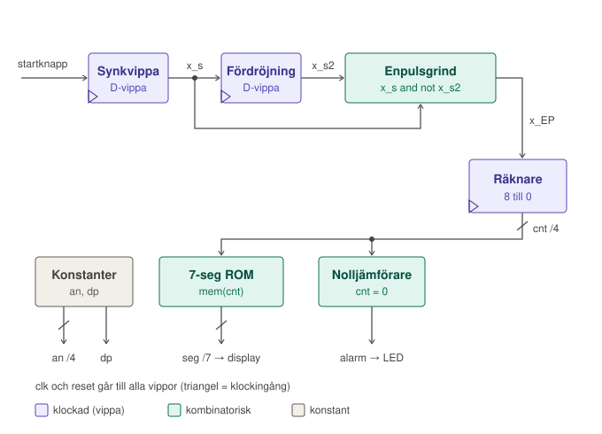
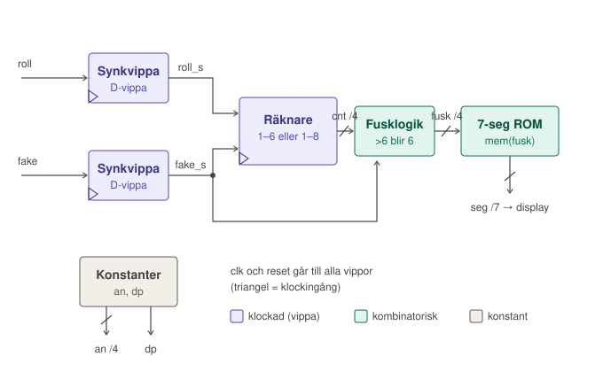

# TSEA51 Digitalteknik – Laboration 3 (VHDL)

VHDL-lösningar till laboration 3 i kursen **TSEA51 Digitalteknik** vid Linköpings universitet (Y-programmet, HT 2026).
Konstruktionerna är skrivna för ett **Basys3**-kort (Xilinx Artix-7) tillsammans med labbmodulen **DigiMod**, och syntetiseras i **Vivado**.

## Innehåll

| Uppgift | Fil | Beskrivning |
|---|---|---|
| 3.3 | `comb_lock.vhdl` | Kodlås (Moore-maskin) |
| 3.4 | `timer.vhdl` | Nedräknande timer 8 → 0 med alarm och 7-segmentsdisplay |
| 3.5 | `dice.vhdl` | Tärning 1–6 med valbart fuskläge |

Till varje konstruktion hör en testbänk (`*_tb.vhdl`) och en constraint-fil (`*.xdc`) som kopplar portarna till kortets ben.

---

## 3.3 Kodlås

Låset öppnas (`u = 1`) när skjutomkopplarna x1x0 ställs i sekvensen **00 → 01 → 11**. Låset stängs igen när insignalen blir 00.

**Konstruktion:**
- **Synkroniseringsvippor** för x1 och x0
- **Tillståndsregister** med 2 bitar (q1 q0) och asynkron reset
- **Nästa-tillståndslogik** som en uppslagstabell (`case`), motsvarande PROM-lösningen från labb 2.1
  - adress: `q1 q0 x1s x0s` (4 bitar)
  - data: `q1+ q0+ u` (3 bitar)

**Moore:** u har samma värde för alla insignaler inom varje tillstånd, och beror därför bara på tillståndet. Låset är öppet i tillstånd `11`.

**Klocka:** sclk ← 32 kHz

---

## 3.4 Timer

En tryckning på startknappen (T0) startar nedräkning från 8. Timern räknar ned med 1 Hz till 0 och stannar där. `alarm` lyser när displayen visar 0. Timern kan inte startas om under pågående nedräkning.

**Konstruktion:**

- **Synkvippa + enpulsare:** `x_EP = x_s and not x_s2` ger en puls som är exakt en klockcykel lång per knapptryck
- **Räknare:** `unsigned(3 downto 0)`. Laddar 8 vid startpuls om den står på 0, räknar annars ned så länge den inte är 0
- **7-segmentsavkodare:** ROM-tabell (`constant`-array) indexerad med `to_integer(cnt)`
- **Display:** aktivt låg. Endast siffran längst till höger används (`an = "1110"`), och decimalpunkten är släckt

**Klocka:** sclk ← 1 Hz

---

## 3.5 Tärning

Medan knappen T0 (`roll`) hålls nere snurrar en räknare med 32 kHz. När knappen släpps stannar den på ett slumpmässigt värde mellan 1 och 6. Med S0 (`fake`) väljs vanlig eller fuskande tärning.

**Konstruktion:**

- **Synkvippor** för `roll` och `fake`
- **Räknare** (`unsigned`, 4 bitar) som räknar 1 → 6 när `fake = 0` och 1 → 8 när `fake = 1`, sedan tillbaka till 1. Reset sätter den till 1
- **Fusklogik:** värdena 7 och 8 visas som 6, så att sexan får 3/8 mot 1/8 för övriga tal, alltså tre gånger så hög sannolikhet
- **7-segmentsavkodare:** ROM-tabell indexerad med `to_integer(fusk)`

**Klocka:** sclk ← 32 kHz

---

## Köra projektet

1. Skapa ett nytt RTL-projekt i Vivado för Basys3 (`xc7a35tcpg236-1`).
2. Lägg till konstruktionsfilen (`.vhdl`) som *design source* och testbänken (`_tb.vhdl`) som *simulation source*.
3. Lägg till motsvarande `.xdc` som *constraint*.
4. **Simulera:** kör *Run Simulation → Behavioral Simulation* och kontrollera att testbänken skriver ut OK för alla test.
5. **Syntetisera och programmera:** *Generate Bitstream → Open Hardware Manager → Program Device*.
6. Koppla sclk på DigiMod till rätt frekvens enligt ovan.

## Generella designregler

Enligt kraven i labbhäftet:
- Endast biblioteken `ieee.std_logic_1164` och `ieee.numeric_std`
- Räknare av typen `unsigned`, inte `integer`
- Asynkron reset av alla tillståndsvippor
- Alla externa insignaler synkroniseras innan de används
- En signal tilldelas bara på ett ställe

---

*Skrivet som en del av kursen TSEA51 vid ISY, Linköpings universitet.*
